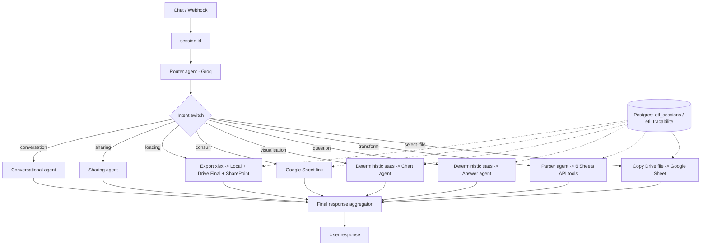

# ETL Process Automation Agent — Sofrecom Tunisia Internship

Agentic conversational agent (n8n) that automates end-to-end Excel file processing: selecting a source file from Google Drive, applying real transformations (cleaning, formatting, dates, deduplication, calculated columns, pivot tables) on a **working copy** Google Sheet, answering questions/statistics computed deterministically (no numbers invented by the LLM), and final multi-destination loading (Local, Google Drive, SharePoint).

Project built as part of an internship at **Sofrecom Tunisia**.

## Table of contents

- [Overview](#overview)
- [Architecture](#architecture)
- [Repository contents](#repository-contents)
- [Quick start](#quick-start)
- [Usage](#usage)
- [Known limitations](#known-limitations)
- [Detailed documentation](#detailed-documentation)

## Overview

The user chats with the agent (n8n chat or webhook) in natural language. A router agent classifies each message into an intent, then routes to the matching sub-flow:

| Intent | What it does |
|---|---|
| `select_file` | Lists the raw Excel files available in Drive, or — if a name is given — creates a working copy and converts it to a Google Sheet |
| `transform` | Applies a real transformation on the working copy: text cleaning (upper/lower/proper case), date normalization, deduplication, calculated column, cell formatting, or pivot table |
| `question` | Answers a numeric question (count, sum, average, distinct values...) using statistics computed in JS on the real data — the LLM only phrases the answer |
| `visualisation` | Proposes a chart configuration from the same real statistics |
| `consult` | Returns the working-copy Google Sheet link at any time, for visual verification |
| `loading` | Exports the working copy to a clean `.xlsx` and delivers it to 3 destinations: local disk, `Final` Drive folder, SharePoint |
| `sharing` | Prepares a share message (email, Slack, Teams...) |
| `conversation` | Regular conversational exchange |

Each session's state (selected file, current working copy, status) is kept in a Postgres table (`etl_sessions`), so a conversation can resume at any time without losing track of the file being processed.

## Architecture



Full technical detail (nodes per branch, the 6 transformation tools' schema, Google Sheets API request shapes): see [`docs/ARCHITECTURE.md`](docs/ARCHITECTURE.md).

## Repository contents

```
Flowrecom ETL — Excel Agentic v2.json          Main n8n workflow (import this)
Flowrecom ETL — BigQuery Native + MCP Agents (2).json   Previous version (kept for historical reference)
etl_sessions.sql                                Postgres schema for session state
docs/ARCHITECTURE.md                            Node-by-node technical detail
docs/SETUP.md                                   Installation and configuration guide
docs/USAGE.md                                   Example conversations per intent
```

## Quick start

1. Self-hosted n8n (tested on n8n 2.17.7).
2. n8n credentials to configure: Groq, Google Drive OAuth2, Google Sheets OAuth2, Google OAuth2 (generic), Postgres.
3. Run `etl_sessions.sql` against the Postgres database in use.
4. In Google Drive, create a source folder (raw Excel files) plus 2 subfolders `Working` and `Final`.
5. Import `Flowrecom ETL — Excel Agentic v2.json` into n8n, replace the `<WORKING_FOLDER_ID>` / `<FINAL_FOLDER_ID>` / `<SHAREPOINT_SITE_ID>` / `<LOCAL_OUTPUT_DIR>` placeholders.

Full step-by-step guide: [`docs/SETUP.md`](docs/SETUP.md).

## Usage

Example messages to send to the agent, and the expected behavior for each: [`docs/USAGE.md`](docs/USAGE.md).

## Known limitations

- The pivot table action (`pivot_table`) manually builds the Google Sheets API's native `pivotTable` object — worth validating on a real case and adjusting if the returned format differs.
- The SharePoint destination requires a separate OAuth2 credential (Azure AD, Graph permission `Sites.ReadWrite.All`) — the branch is wired but inactive until that credential exists.
- Writing the final file locally requires `N8N_RESTRICT_FILE_ACCESS_TO` to allow the output folder (n8n restricts disk access by default).

## Detailed documentation

- [Technical architecture](docs/ARCHITECTURE.md)
- [Setup guide](docs/SETUP.md)
- [Usage examples](docs/USAGE.md)
